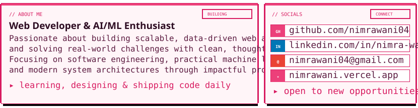
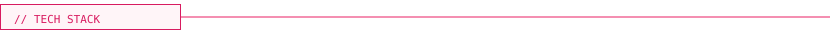

  <!-- PIXEL INTRO BOX -->
  

    
  

  <!-- TYPING ANIMATION -->
  <picture>
    <source media="(prefers-color-scheme: dark)" srcset="readme/typing-dark.svg">
    
  </picture>

  <!-- ABOUT ME / SOCIALS PIXEL PANEL -->
  <picture>
    <source media="(prefers-color-scheme: dark)" srcset="readme/now-dark.svg">
    
  </picture>

<!-- FULL-WIDTH PIXEL CODING GIF -->

  

  <!-- TECH STACK HEADER -->
  <picture>
    <source media="(prefers-color-scheme: dark)" srcset="readme/h-stack-dark.svg">
    
  </picture>

  <h3>💻 Languages & Frameworks</h3>

  <picture>
    <source media="(prefers-color-scheme: dark)" srcset="readme/marquee-languages-dark.svg">
    
  </picture>

  <h3>🧠 AI, Machine Learning & Data Science</h3>

  <picture>
    <source media="(prefers-color-scheme: dark)" srcset="readme/marquee-aiml-dark.svg">
    
  </picture>

  <h3>🗄️ Databases, Cloud & Developer Tools</h3>

  <picture>
    <source media="(prefers-color-scheme: dark)" srcset="readme/marquee-tools-dark.svg">
    
  </picture>

  <!-- GITHUB STATS HEADER -->
  <picture>
    <source media="(prefers-color-scheme: dark)" srcset="readme/h-stats-dark.svg">
    
  </picture>

  <!-- STREAK STATS -->
  <picture>
    <source
      media="(prefers-color-scheme: dark)"
      srcset="https://streak-stats.demolab.com/?user=nimrawani04&card_width=355&border_radius=0&background=160b1d&border=ff79c6&stroke=ff79c6&ring=ff79c6&fire=ff2a85&currStreakLabel=ff79c6&sideLabels=ffb8d2&dates=ff79c6&currStreakNum=ffffff&sideNums=ffffff"
    >
    <source
      media="(prefers-color-scheme: light)"
      srcset="https://streak-stats.demolab.com/?user=nimrawani04&card_width=355&border_radius=0&background=fff5f8&border=d81b60&stroke=d81b60&ring=d81b60&fire=ec407a&currStreakLabel=d81b60&sideLabels=ad1457&dates=d81b60&currStreakNum=2d0c22&sideNums=2d0c22"
    >
    
  </picture>

  <!-- TOP LANGUAGES -->
  <picture>
    <source
      media="(prefers-color-scheme: dark)"
      srcset="https://github-readme-stats.vercel.app/api/top-langs/?username=nimrawani04&bg_color=160b1d&title_color=ff79c6&text_color=ffb8d2&border_color=ff79c6&border_radius=0&layout=compact"
    >
    <source
      media="(prefers-color-scheme: light)"
      srcset="https://github-readme-stats.vercel.app/api/top-langs/?username=nimrawani04&bg_color=fff5f8&title_color=d81b60&text_color=5c1b40&border_color=d81b60&border_radius=0&layout=compact"
    >
    
  </picture>

<!-- GITHUB BREAKOUT GAME -->
<picture>
  <source media="(prefers-color-scheme: dark)" srcset="https://raw.githubusercontent.com/cyprieng/github-breakout/main/example/dark.svg">
  <source media="(prefers-color-scheme: light)" srcset="https://raw.githubusercontent.com/cyprieng/github-breakout/main/example/light.svg">
  
</picture>

<!-- CLICKABLE SOCIALS -->

  
  
  
  

  <!-- PIXEL PORTFOLIO BUTTON -->
  

    <a href="https://nimrawani.vercel.app/">
      <picture>
        <source media="(prefers-color-scheme: dark)" srcset="readme/visit-dark.svg">
        
      </picture>
    </a>
  

<!-- BOTTOM ANIMATION -->

  

